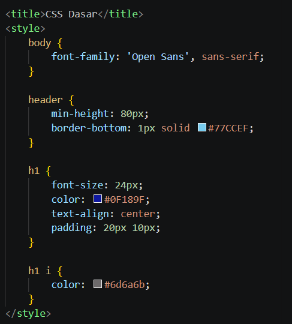
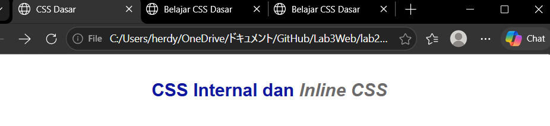
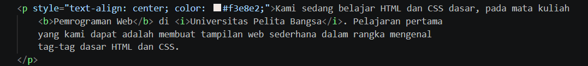
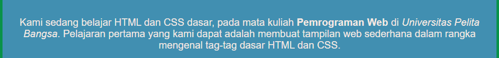
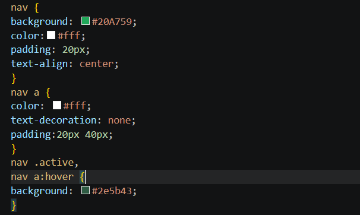
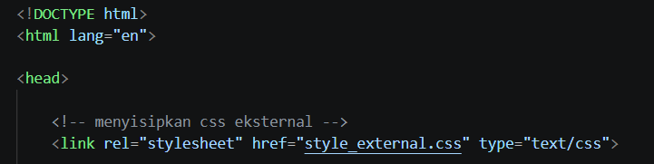
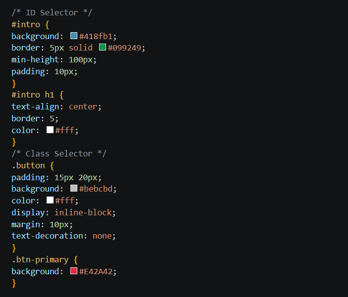
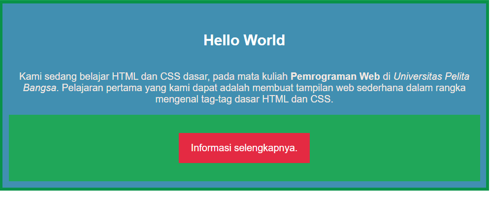

# Lab2Web

Repository ini berisi hasil praktikum Pertemuan 5 pemograman web.

## 1. mendeklarasikan internal CSS

Pada tahap ini Kita mempelajari mendeklarasikan css secara internal

### Hasil

 

---

## 2. menambahkan inline CSS

Pada tahap ini kita mempelajari cara menambahakan inline pada CSS

### Hasil

/

---

## 3. Membuat CSS External

Pada tahap ini Kita mempelajari cara membuat dan mendeklarasikan css secara external
### Hasil

---

## 4. Menambahkan CSS Selector
Pada tahap ini mempelajari bagaimanan cara menambahkan css selector.

### Hasil

---

## 10. Kesimpulan

Pada praktikum ini saya mempelajari cara menggunakan dan mengaplikasikan CSS pada HTML.
